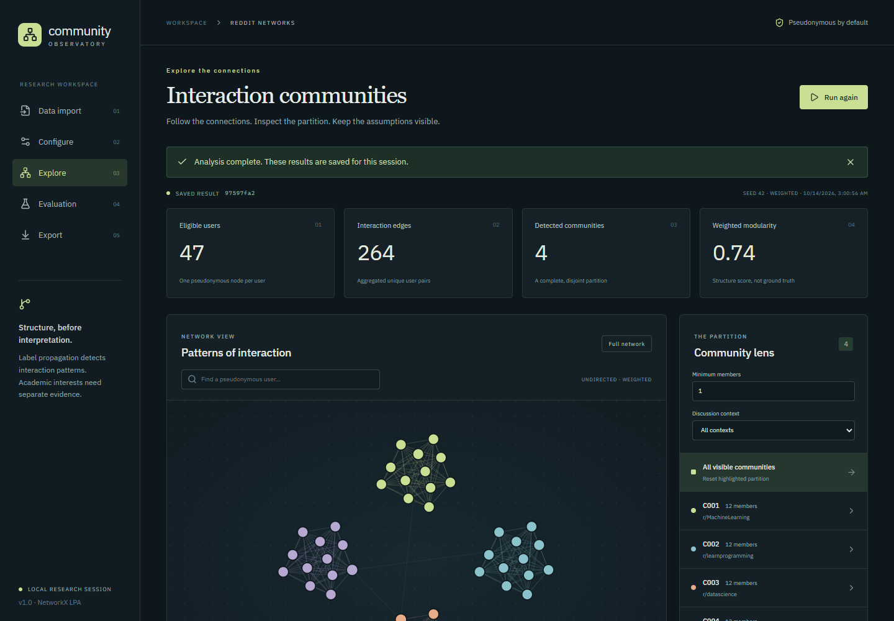

# Community Observatory

**Reddit Academic Community Intelligence** — reproducible interaction-community
analysis using weighted asynchronous label propagation.



Import a CSV, inspect its data-quality report, configure an analysis, explore the
partition, compare seed sensitivity, and export memberships and reproducible evidence.
LPA detects **interaction communities**. Subreddit participation is a separate context
layer; the application does not infer verified academic interests or expertise.

## Run locally

Requires Python **3.12**, Node **22.12+**, npm, and [uv](https://docs.astral.sh/uv/).

```powershell
git clone https://github.com/rdx644/Community-Detection-Using-Label-Propogation.git
cd Community-Detection-Using-Label-Propogation
uv sync --frozen
cd frontend
npm ci
npm run build
cd ..
uv run python app.py
```

Open **http://127.0.0.1:8000** and choose **Explore the synthetic sample**.
One process serves the React application and FastAPI API. For UI development, run
`uv run python app.py` and `npm run dev` from frontend in separate terminals; Vite
proxies `/api` to port 8000. No Reddit account, token or live ingestion is needed.

## Verify

```powershell
uv run ruff check .
uv run ruff format --check .
uv run mypy
uv run pytest -q
uv run python scripts/scan_secrets.py
uv run pip-audit -r requirements.lock
cd frontend
npm run format:check
npm run lint
npm test
npm run build
npm audit --audit-level=high
cd ..
uv run python scripts/smoke_test.py
uv run python scripts/browser_gate.py
uv run python scripts/benchmark.py
uv run python scripts/fresh_install.py
```

If Chrome is unavailable, run `npx playwright-cli install-browser chrome` in frontend
before the browser gate. GitHub Actions repeats the quality/security/workflow gates
and builds the release container. Actual local evidence is in [phase gates](artifacts/verification/phase_gates.md).

## Data and algorithm

Required CSV columns: `source_user,target_user,interaction_type,timestamp,subreddit`.
Optional: `interaction_id,weight,post_id,text`. Input is UTF-8 and requires timezone-aware
ISO-8601 timestamps. Types: reply, mention, shared_discussion. Default weight is 1.
The UI supports explicit column mapping when source headers differ.

Valid events are deduplicated before user-pair weights are summed. Self-loops are removed;
invalid rows are quarantined and counts reconcile. Time/type/subreddit/edge-strength
filters are explicit. Eligible isolates remain singleton communities. NetworkX 3.7
`asyn_lpa_communities` uses recorded seeds and sorted graph construction. No invented
iterations or convergence traces are shown.

The bounded graph display includes up to 400 nodes / 1,500 edges; full metrics and
memberships remain available in exports. Results include actual weighted modularity,
community sizes, internal-edge fraction, runtime, pairwise adjusted Rand index, run ID,
dataset/membership hashes and software versions. CSV/JSON/Markdown downloads share
the same saved analytical artifact.

## Source layout

```text
src/reddit_communities/   ingestion, graph, LPA, evaluation, stability, API and jobs
frontend/src/            React screens, React Bits CountUp, generated HTTP types
tests/                   unit, integration, generated graph, regression and security
data/sample/             deterministic synthetic CSV
scripts/                 schema/sample generation, checks, benchmarks and smoke gates
docs/                    contracts, decisions, risks, traceability and user/release guides
artifacts/               actual synthetic results and verification evidence
.github/workflows/       mandatory automated quality and container gates
```

## React Bits MCP

The supplied `C:\Users\putit\.codex\mcp\config.toml` config launches the shadcn stdio
MCP server. [React Bits registry setup](https://reactbits.dev/get-started/mcp) is captured
in `frontend/components.json`; the MCP SDK client in `frontend/scripts/mcp-inspect.mjs`
used it to discover, search, inspect and obtain the install command for **CountUp-TS-CSS**.
Tool-call evidence is preserved under `artifacts/verification/mcp-*.json`.

CountUp animates only actual saved metrics and respects reduced-motion preferences.
The React frontend replaces the original plan's Streamlit recommendation as explicitly
requested; Python domain modules remain independent of the dashboard.

## Limits and deployment

Default budgets: 5 MiB / 50,000 input rows, 10,000 nodes / 50,000 edges, two analysis
workers with 60-second deadlines, 20 retained datasets/runs, 30-minute session retention.
Raw IDs/text are kept only in expiring memory; public artifacts use dataset-scoped
pseudonyms. Pseudonyms are not a guarantee of anonymity. Server restarts discard state;
download results before expiry. Successful runs survive subsequent failed analyses.

Native deployment and a multi-stage non-root Docker package are included. A public
deployment needs a trusted authentication/rate-limiting proxy and HTTPS. No cloud
deployment or live URL is claimed. See [deployment](docs/deployment.md).

## Research documentation

- [Requirements and gates](docs/requirements.md), [architecture/interfaces](docs/architecture.md), [data contract](docs/data_contract.md)
- [Algorithm and mathematics](docs/algorithm_spec.md), [user guide](docs/user_guide.md), [test plan](docs/test_plan.md)
- [Requirement-to-test traceability](docs/traceability.csv), [benchmark](docs/benchmark_report.md), [limitations](docs/limitations.md)
- [Release checklist](docs/release_checklist.md), [decisions](docs/decision_log.md), [risks](docs/risk_register.md)

Third-party source retains its original notices: [React Bits license](docs/REACT_BITS_LICENSE.md)
and [IBM Plex font license](docs/IBM_PLEX_LICENSE.txt).
